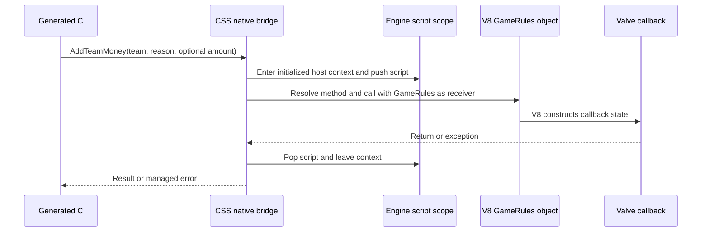

# CounterStrikeSharp cs_script API implementation handover

## Objective and implementation status

Add a CounterStrikeSharp C++ bridge that invokes Valve's registered V8 methods, with generated, typed C# wrappers. Start with `GameRules.AddTeamMoney`, then support methods on ordinary entity wrappers. A C# `CCSGameRules` convenience method can validate the current game-rules pointer and forward through the same bridge.

Work from the repository root, `C:/Users/MICHAEL/source/repos/CounterStrikeSharp`. All implementation paths below are relative to that directory. This handover belongs at `docs/counterstrikesharp-cs-script-handover.md`, with its examples under `docs/examples/cs_script/` and the fetched master references under `docs/references/cs_script/master/`.

An experimental Linux adapter, generator, managed API and live-server tests are now implemented and build in the devcontainer. Live engine initialization and invocation still require validation. The binary findings below were inspected against the Linux `14192` libserver.

The implemented ownership model supersedes the per-plugin runtime and compiled-fixture proposals below: CS# automatically creates one empty `point_script` context per map. Plugins access `CsScriptRuntime.Shared` on the game thread and do not create or dispose it. Core shutdown invalidates the session; unexpected host deletion schedules replacement. Cached facades must be reacquired after a map change or replacement. No compiled script asset or addon loader is needed. Calls use stable signature hashes and typed native argument/result slots rather than JSON. See [current runtime and transport notes](../tools/cs-script-generator/README.md) and [live test instructions](../managed/CounterStrikeSharp.Tests.Native/README.md).

The first milestone is a complete invocation through V8, with an observed hit on Valve's callback. Calling the underlying native money routine directly does not meet that milestone.

## Inputs from master

The local reference files were fetched through the GitHub connector with **`ref=master`**, using the user-specified repository and path:

- [point_script.d.ts](references/cs_script/master/point_script.d.ts), upstream blob `36c59a00b4d35262337cfaa74fdadb92ac035ed8`.
- [tsconfig.json](references/cs_script/master/tsconfig.json), upstream blob `cce858a58fdcc61320a42ee3369b6f56dece33b6`.
- [Source metadata](references/cs_script/master/source.json) records the branch, paths, URLs, and returned blob hashes. These are file hashes, not claims about a repository commit or binary version.

Use these master copies for the initial generator and examples. Do not substitute an older tree. Refresh explicitly from master when updating the API and review the generated diff. A declaration update is not proof that a deployed server implements every declared member; keep the runtime compatibility check separate.

The fresh declaration exports `Instance: IPointScript`, `Console: IConsole`, and `GameRules: IGameRules`. The old money method on `Instance` is deprecated. Generate the primary API from `GameRules`, retaining deprecated aliases only if deliberately supported. The exact declaration is:

```ts
AddTeamMoney(team: number, reason: CSTeamMoneyReason, amount?: number): void;
```

Parameter and return shapes come from `.d.ts`. `tsconfig.json` supplies compiler settings; the fetched configuration enables strict checking, targets ES2022, checks JavaScript, and disables emit. It neither generates `.vjs_c` resources nor specifies native ABI layouts. See the [master declarations](https://github.com/SteamTracking/GameTracking-CS2/blob/master/content/csgo_addons/cs_script_demo/maps/scripts/point_script.d.ts) and [master compiler configuration](https://github.com/SteamTracking/GameTracking-CS2/blob/master/content/csgo_addons/cs_script_demo/maps/scripts/tsconfig.json).

## Script host creation

Use an engine-created script entity to obtain a correctly constructed `CCSBaseScript`. The [cs_script introduction](https://www.source2.wiki/Scripting/Counter-Strike%202/cs_script/introduction) describes **`point_script` as the entity classname** and **`cs_script` as its script-asset field**. The binary also contains the classname `point_script`. The suggested `CreateEntityByName("cs_script")` spelling is therefore not established by that documentation; validate a separate alias before using it.

Start with the existing CSS call:

```csharp
var host = Utilities.CreateEntityByName<CCSPointScriptEntity>("point_script");
```

This creates an entity, not a proven ready scripting environment. Configure the script asset before `DispatchSpawn`, using the existing `CEntityKeyValues` and `DispatchSpawn(CEntityKeyValues)` path. Determine the precise key name/resource representation from the entity's spawn implementation or a known working map. The documented asset field is `cs_script`; do not assume `SetString` alone establishes the correct resource value.

Use a tiny compiled script asset for the first test. Confirm resource mounting, compilation to `.vjs_c`, spawn, activation, module registration, and a nonempty context. A scriptless host might suffice for native-only invocation, but prove that separately. Do not manually allocate or call the `CCSBaseScript` constructor as the initial approach.

The JS specimen is [bridge_fixture.js](examples/cs_script/bridge_fixture.js). Compile it with the game's resource pipeline and mount it where the dynamically spawned entity can resolve it. A readiness handshake must identify the host/context, not just match a global console message.

## Binary findings to resume in MCP

Connect to `http://127.0.0.1:24642/mcp`. Call `bn_binary_view_list`, then select the intended ELF view with `bn_binary_view_set_active`; handles are session-specific. The inspected file was `C:/Users/MICHAEL/Downloads/cs2-archive-1.41.9.2/libserver.so`, image base zero. Use the MCP client's available Binary Ninja tools; no helper script from the earlier investigation is required or included in this handover.

These addresses are **Linux 14192 lookup anchors**, not portable offsets. Role names are reverse-engineered unless explicitly identified by RTTI or an import. Correct prototypes from assembly and imported ABI definitions before calling them; Binary Ninja currently misidentifies several script-object arguments as `v8::Isolate*`.

| Address or offset | Observed behavior |
| --- | --- |
| `0xAD4BF0` | Constructs an object identified by RTTI as `CCSBaseScript`; calls `v8::Context::New` and retains a persistent context handle at object `+0x28`. |
| `0xAD4EC0` | Resolves that persistent context into a local handle. It does not take an arbitrary entity pointer. |
| `0xAD55A0` | Pushes a script object onto the active-script stack. |
| `0xAD56E0` | Pops the stack by decrementing its count. Balance every push even on exceptions. |
| `0xAD56F0` | Gets the top script object, or zero when the stack is empty. |
| `0x283E530`, `0x283E538` | Active-script count and backing-array pointer. Useful for diagnostics; avoid direct writes. |
| `0xB0EEB0` | Engine invocation path: enters isolate/context, pushes the script at owner `+0x7A0`, dispatches a named script input, then pops/exits. Verify the owner type and this offset before using it. |
| `0xADE6C0` | Looks up a registered script callback by name, then delegates to `0xADE470`. This is a callback registry, not established as arbitrary member lookup. |
| `0xADE470` | Calls the imported `v8::Function::Call` and handles exceptions. Its current call path uses an undefined receiver, so it cannot simply replace member invocation requiring a specific `this`. |
| `0xB912D0` | Converts a native entity into an appropriate V8 wrapper, including a generic `Entity` fallback. |
| `0xB8E960` | Reuses or creates entity wrappers within the active script, keyed by entity handle. Stores a wrapper-kind tag and entity handle. |
| `0xB6EC50` | Unwraps script objects after checking embedder fields and a marker. |
| `0xB70B00` | `ScriptBinding_Entity_SetEntityName`: requires an active script, validates wrapper kind and entity handle/serial, then calls the native setter. |
| `0xB8E520` | Registers the `GameRules` template and its methods. |
| `0xB82E20` | Method-registration helper using V8 FunctionTemplate creation, string creation, and Template::Set. |
| `0xB82890` | V8 `AddTeamMoney` callback; named `GameRules_AddTeamMoney_Callback` during this session. Still not an analyzed function at the last inspection. |
| `0xB8E860` | Instantiates an API object from a template, with wrapper-kind tag 1 and its owning script pointer. Entity wrappers instead use kind 2. |
| `0xAE6000` | Retains a named template in a per-script registry; registration uses the name `GameRules`. |
| `0xAD50A0` | Module-export construction path; gets the active script, searches named template registries, and instantiates API objects. Useful for resolving the actual GameRules export. |
| `0x2A05968` | `g_pGameRules`, also confirmed by the artifact `bin_artifacts/14192/server/g_pGameRules.linux.yaml` in the separate CS2_VibeSignatures repository. That artifact path is not relative to this CounterStrikeSharp checkout. |
| `0x13EFEE0`, `0x13EFEA0` | Native money paths called from the callback. The latter checks the team cash-award setting. Do not use them to bypass V8 in this feature. |

The ordinary-entity private-scope path also exists at `CEntityInstance_ValidatePrivateScriptScope` (`0x2295720`). It calls a separate VM interface through a global at `0x28A0668`. Do not assume its opaque handles are V8 contexts or interchangeable with the newer `CCSBaseScript` path.

### Important receiver distinction

`CCSGameRulesProxy` is an entity; its `.GameRules` property yields the native `CCSGameRules` object. That object is not the kind-2 entity wrapper expected by `0xB912D0`. `GameRules.AddTeamMoney` uses a kind-1 script API object and ultimately reads `g_pGameRules` itself. A managed convenience method on `CCSGameRules` must validate that it represents the current singleton and dispatch using the session's GameRules API object.

The callback needs both genuine V8 callback state and an engine active-script scope. Do not fabricate `v8::FunctionCallbackInfo`, pass `CCSGameRules*` as the callback's first argument, or replace the receiver with an arbitrary object containing a native pointer.

## Runtime design



Introduce a native `CsScriptRuntime` session associated with a script-host entity handle and a generation token. Establish these boundaries:

1. **Host lifecycle:** create/configure/spawn on the game thread; wait for readiness without blocking it; bind to the constructed script object; release handles before host deletion. Initially one explicit session is easier to validate than an implicit global session.
2. **Invocation scope:** enter the existing game isolate, open a handle scope, enter the host context, and push the host's `CCSBaseScript`. Use exception-safe guards and reverse the operations on every exit. Prefer engine scope helpers where their ABI is established. Never instantiate a second V8 runtime.
3. **Receiver resolution:** resolve module exports and their actual API instances for `GameRules`/`Console`/`Instance`; use the engine wrapper converter for ordinary entities. A FunctionTemplate or registry entry is not necessarily the live receiver object.
4. **Value conversion:** marshal a typed argument tree, resolve the named function, and call V8 with the correct receiver. A native C++ call to V8 is sufficient; evaluating generated JS text is unnecessary.
5. **Results/errors:** copy supported results out of local handles before leaving the scope. Convert V8 exceptions to a managed exception including export, member, and useful script stack information. No local V8 handles may escape an invocation.

Use the V8 headers, ABI, build flags, and exported entry points matching the game. Check how the game supplies its V8 library and isolate; linking a separate stock V8 build is not an established integration path. Keep V8 C++ types entirely inside the native layer and cross the CSS managed boundary with stable IDs and tagged values.

Expose proposed calls such as:

```csharp
runtime.GameRules.AddTeamMoney(3d, CSTeamMoneyReason.NONE, 100d);
runtime.Entity(entity).SetEntityName("css_bridge_probe");
gameRules.Script(runtime).AddTeamMoney(3d, CSTeamMoneyReason.NONE, 100d);
```

These are proposed APIs, not existing CSS methods. Generate the numeric signature accurately, then optionally add a `CsTeam` convenience overload. Avoid an ambiguous `entity.InvokeScript` that silently selects whichever map script happens to be active.

Reject invocation from worker threads initially. Reject unready, disposed, deleted-host, or stale-generation sessions. Destroy/rebuild per-session caches on map changes, host destruction, plugin unload, and relevant script reloads. If V8 work can reenter CSS, preserve the previous active script and support nesting rather than clearing a global stack. Promise-returning members require a separate asynchronous lifetime design; do not silently coerce them into synchronous results.

## Generate parameter shapes with the TypeScript compiler

Build a TypeScript Program using `readConfigFile`, `parseJsonConfigFileContent`, and `createProgram`, ensuring the fetched `.d.ts` is included among root files. Use the TypeChecker to inspect module exports and resolve aliases. Walk exported constant types such as `IGameRules` as well as exported classes, inherited members, overloads, enums, and referenced object shapes. A regex scan or class-only walker will miss the current API.

Emit a deterministic intermediate manifest first; generate C# methods and shared marshalling descriptors from that manifest. Keep public module/export/member identity distinct from reverse-engineered registration helpers. The example descriptor is [AddTeamMoney.shape.json](examples/cs_script/AddTeamMoney.shape.json). It is a hand-authored expected output, not the result of a completed generator.

| TypeScript feature | Generation and runtime rule |
| --- | --- |
| `number` | Default to C# `double` and JS Number. An explicit override may expose an integer/float convenience type where validated. A TS number alone does not prove an int32 ABI. |
| `boolean`, `string`, `void` | Preserve boolean values, UTF-8 strings, and absence of a return value. |
| Enum | Evaluate initializers using the compiler; preserve member values and names. Do not substitute a similarly named CSS enum. |
| Optional argument | Emit overloads or an explicit optional-value representation. Omission, `undefined`, `null`, and numeric zero must remain distinguishable. |
| Optional property or union | Preserve omission and union alternatives. Use a presence flag/optional type when C# nullable cannot express the required states. |
| Object shape, alias, intersection | Generate named records and compose fields without flattening away optionality. Reuse structurally identical shapes deliberately. |
| Array | Marshal each element according to its descriptor; validate element types before invoking V8. |
| Entity reference | Pass an engine handle plus session identity to the native bridge; resolve serial/type and obtain that session's wrapper. Never serialize raw entity pointers as JS numbers. |
| Function, event, generic, Promise, `any` | Emit an explicit unsupported diagnostic in milestone one unless a complete ownership/conversion contract is implemented. Do not generate a misleading working stub. |

Retain documentation/deprecation metadata and preserve upstream spelling, including misspelled identifiers. Generate compile/golden tests for overload selection, enum values, inherited methods, optional object fields, nested arrays, and unsupported features. Do not generate generated-schema class edits in CSS; add a separate scripting namespace and handwritten extension methods.

For `AddTeamMoney`, preserve the order `team`, `reason`, `amount`. Generate a two-argument overload that sends argc=2 and a three-argument overload that sends argc=3. Runtime documentation associates omitted/zero amount with the server's configured reward for the reason. Do not implement optionality by always substituting zero; test both calls independently.

## Tests and proof of routing

The [C# test specimen](examples/cs_script/CsScriptBridgeTests.cs.example) describes the intended test-facing API. It deliberately has an `.example` suffix and depends on a future fixture/runtime. The declaration files are real upstream master copies; the tests are implementation requirements, not passing live-server evidence.

Implement `CsScriptBridgeFixture` in `managed/CounterStrikeSharp.Tests.Native` with these responsibilities:

- Create a fresh `point_script`, configure a compiled test asset, spawn it, and wait for its context/module readiness with a bounded timeout. Run all native actions and cleanup on the game thread.
- Provide `RunAsync`, executing an assertion block on that thread; provide an attached runtime whose host lifetime is fixture-owned.
- Expose a test-only observation of the Valve V8 callback resolved for the current build, so a money test proves V8 routing rather than merely seeing a successful balance change.
- For money tests, establish a controlled match with cash awards enabled, one or more eligible CT players, sufficient headroom below the account limit, and an opposing control player. Prevent concurrent awards/restarts; restore convars and test-owned state afterward. Fail clearly if the dedicated test scenario is missing.

First pass a read-only smoke test: compare `runtime.GameRules.IsWarmupPeriod()` to the native game-rules schema state. Then test entity wrapping by setting a fresh `info_target` name through V8 and reading it back through CSS. Finally test an explicit money amount and omitted amount against the selected reason's configured reward, observing callback entry for both.

Additional required cases: invalid receiver/serial, unsupported method, script exception followed by a successful call, balanced stack after failure, nested invocation restoring the prior script, distinct wrapper identity between two sessions, host removal, round restart, map change, reload, and worker-thread rejection. Test fresh dedicated-server startup without a preexisting map script to prove that the fixture creates the required environment itself.

Use the existing native test plugin's `css_itest CsScriptBridgeTests` filter after the fixture is implemented. A managed `dotnet test` run alone cannot prove V8/engine integration.

## Suggested implementation locations

Paths below are relative to the CounterStrikeSharp checkout and are proposed additions unless already present:

| Area | Entry points |
| --- | --- |
| Native session and invocation | New `src/core/cs_script_runtime.{h,cpp}`; keep versioned engine addresses behind a small adapter. |
| Managed/native boundary | New `src/scripting/natives/natives_cs_script.cpp`; follow `autonative.h` and the existing CSS `ScriptContext` convention. CSS's ScriptEngine is its own interop dispatcher, not Valve's V8 VM. |
| Generated managed API | New `managed/CounterStrikeSharp.API/Modules/CsScript/`; keep DTOs, session handles, and generated facades separate. |
| GameRules convenience | Extend existing `managed/CounterStrikeSharp.API/Core/Model/CCSGameRules.cs`; validate the native singleton and forward through the session. |
| Generator | New `tools/cs-script-generator/`, with explicit master refresh and recorded source hashes. |
| Integration tests | Existing `managed/CounterStrikeSharp.Tests.Native/`; follow its xUnit fixture and game-thread scheduling patterns. |
| Engine lookup | Existing gameconfig/memory resolution. Add validated signatures/offsets for each supported platform/build; do not ship the addresses in this handover as constants. |

Maintain runtime lookups through CounterStrikeSharp's existing gameconfig/memory conventions. If a change also requires new symbol artifacts, the separate signatures checkout is `C:/Users/MICHAEL/source/throwaway-repos/CS2_VibeSignatures`; its canonical artifacts belong under `bin_artifacts/<GAMEVER>/<module>/*.yaml`. The implementation does not require that checkout at runtime. The bundled declaration files and example manifest are documentation inputs, not binary symbol artifacts.

## Implementation sequence and remaining checks

1. Validate `point_script` creation, the precise spawn key/resource representation, and whether a mounted minimal asset is required on dedicated servers. Confirm its embedded `CCSBaseScript` location from constructor/call-site evidence; `+0x7A0` is only a build-specific observation.
2. Find a reusable engine invocation guard or establish the exact isolate/context/push/pop ABI. Identify how the live GameRules export is obtained after module setup. Avoid assuming it is a property on the V8 global object.
3. Implement a read-only call and the exception/error path, then ordinary entity conversion. Add session lifecycle tests before caching handles.
4. Hand-author only the example money descriptor and enum subset needed for the proof. Route the call through the real GameRules object and observe Valve's callback.
5. Build the declaration generator against the saved master reference, replace the handwritten descriptor, and expand supported shapes incrementally with meaningful tests.
6. Validate Linux and Windows separately, including V8 ABI compatibility, resource packaging, teardown, repeated map changes, and independent plugin sessions.

No live test in this handover proves that an empty dynamically created host initializes all exports, that the observed owner offset applies to every script entity, or that a generated shape is supported by every server build. Resolve those specific checks before advertising a general invocation API.

## Reference links

- [Source2 wiki introduction](https://www.source2.wiki/Scripting/Counter-Strike%202/cs_script/introduction).
- [Upstream master declaration source](https://raw.githubusercontent.com/SteamTracking/GameTracking-CS2/refs/heads/master/content/csgo_addons/cs_script_demo/maps/scripts/point_script.d.ts).
- [Upstream master tsconfig](https://raw.githubusercontent.com/SteamTracking/GameTracking-CS2/refs/heads/master/content/csgo_addons/cs_script_demo/maps/scripts/tsconfig.json).
- [V8 native function invocation](https://v8.github.io/api/head/classv8_1_1Function.html) and [context management](https://v8.github.io/api/head/classv8_1_1Context.html). These describe the API concepts; use headers matching the game's V8 build.
